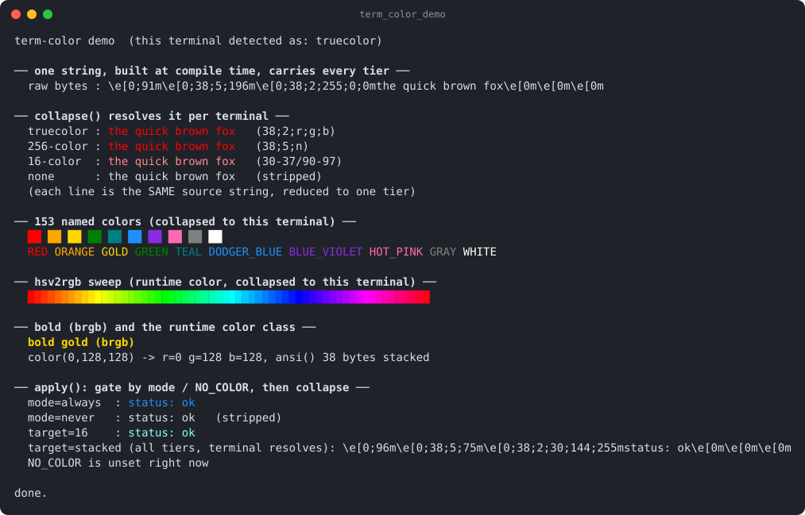

# term-color

[](https://github.com/Kronuz/term-color/actions/workflows/ci.yml)
[](LICENSE)


Compile-time ANSI terminal colors for C++20: 151 named colors that expand to
escape sequences at compile time, portable across 16-color, 256-color, and
truecolor terminals, plus a runtime layer that honors `--color`, `NO_COLOR`, and
pipes. For colored logs and command-line tools.



## ✨ Highlights

- **Zero runtime cost.** `RED + "error" + CLEAR_COLOR` is one compile-time
  constant.
- **151 named colors** from `ALICE_BLUE` to `YELLOW_GREEN`, plus `rgb()` and bold
  `brgb()` for your own.
- **Portable by default.** Each color carries 16-color, 256-color, and truecolor
  escapes; the terminal keeps the best one it understands.
- **Correct for pipes and logs.** `apply()` resolves colors to one tier, or strips
  them, by `--color` mode, `NO_COLOR`, and whether the sink is a terminal.
- **Runtime colors too.** `hsv2rgb` and a `color` class for values known only at
  runtime.

## 📦 Installation

Requires a C++20 compiler and CMake 3.14 or newer; it fetches
[static-string](https://github.com/Kronuz/static-string). CI builds it on Linux
(x86_64, arm64), macOS (arm64, x86_64), and FreeBSD, plus ASan, UBSan, and TSan
builds.

```cmake
include(FetchContent)
FetchContent_Declare(term_color
  GIT_REPOSITORY https://github.com/Kronuz/term-color.git
  GIT_TAG        main)
FetchContent_MakeAvailable(term_color)

target_link_libraries(my_app PRIVATE term_color::term_color)
```

## 🚀 Quick start

```cpp
#include "colors.h"
#include "collapse.hh"

#include <cstdio>
#include <string>
#include <unistd.h>

int main() {
	constexpr auto line = RED + "error: " + CLEAR_COLOR;   // compile time

	// One tier for this terminal; plain text when piped or NO_COLOR is set.
	std::string out = term_color::apply(std::string(line) + "disk full\n",
		term_color::mode::automatic, term_color::target::automatic, ::isatty(1));
	std::fwrite(out.data(), 1, out.size(), stdout);
}
```

[`examples/demo.cc`](examples/demo.cc) prints swatches, an HSV rainbow, and one
string collapsed to each depth.

## 🎯 When to use it

- ✅ Colored output from a CLI or a logger, with `--color` and `NO_COLOR` handled.
- ❌ Full-screen terminal UIs: this colors text; it does not move the cursor or
  manage the screen.
- ❌ Windows consoles without virtual-terminal sequences enabled.

## 📚 Documentation

- [docs/API.md](docs/API.md): named colors, `rgb`/`brgb`, the runtime `color`
  class, and resolving with `apply()` and `collapse()`.
- [ARCHITECTURE.md](ARCHITECTURE.md): how the three stacked tiers are built and
  collapsed.
- [AGENTS.md](AGENTS.md): repository map, invariants, and traps.

## 🛠️ Building and testing

```sh
cmake -B build && cmake --build build && ctest --test-dir build
./build/term_color_demo
```

## 🤝 Contributing

Issues and pull requests are welcome. Read [AGENTS.md](AGENTS.md) first. CI must
pass on every platform.

## 📄 License

MIT, Copyright (c) 2015-2019 Dubalu LLC. See [LICENSE](LICENSE). Extracted from
[Xapiand](https://github.com/Kronuz/Xapiand), where it colors the logs.
